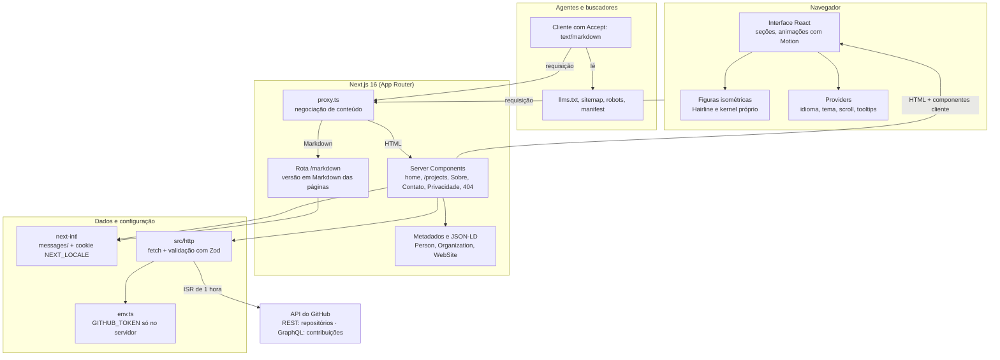

<div align="center">

# Anderson Kaiti · Portfólio

### Desenvolvedor Full-Stack Júnior. Código que sobrevive ao próximo release

Portfólio bilíngue (pt-BR e en) que mostra projetos, resultados e experiência, com figuras isométricas de linha fina que reagem ao mouse.

[](https://nextjs.org/)
[](https://react.dev/)
[](https://www.typescriptlang.org/)
[](https://tailwindcss.com/)

</div>

## Sobre

Site pessoal feito com Next.js (App Router) que lê a API do GitHub no servidor para listar os repositórios, com revalidação a cada hora. A home conta uma história curta: o problema, o método (medir, construir, provar), os resultados, o formato de trabalho e o contato.

Seções da home: Hero, Dor, Soluções, Método, Resultados, Trabalhe comigo, Experiências, Projetos, Risco, FAQ e Contato. Há também a página `/projects` (com busca e filtro por tecnologia) e as páginas de texto Sobre, Contato e Privacidade.

## Destaques

| Destaque | O que faz |
| -------- | --------- |
| **Figuras isométricas interativas** | Desenhos de linha fina feitos com [`@lucasmarkes/hairline`](https://www.npmjs.com/package/@lucasmarkes/hairline) e algumas figuras próprias (barras de tempo de carga, pilha de camadas, painel de chaves). Usam as cores do tema e reagem ao mouse. |
| **Dois idiomas** | Português (pt-BR) e inglês, com o idioma guardado em cookie e os textos em `messages/`. |
| **Tema claro e escuro** | Com transição circular ao trocar. |
| **Animações com [Motion](https://motion.dev/)** | FAQ, filtro de projetos, números que rolam e entrada dos cards. Tudo respeita `prefers-reduced-motion`. |
| **Dados do GitHub no servidor** | Projetos e gráfico de contribuições vêm de Server Components com ISR (`revalidate: 3600`), sem chamadas no cliente. O token nunca vai para o navegador. |
| **Pronto para agentes e buscadores** | Negociação de conteúdo (`Accept: text/markdown` devolve Markdown), `llms.txt`, JSON-LD (Person, Organization e WebSite), sitemap, `robots.txt` e um 404 em Markdown. |
| **Página 404 própria** | Com um empty state: uma gaveta vazia. |

## Arquitetura



**Como as peças se encaixam**

| Camada | Papel |
| ------ | ----- |
| **Proxy** | Olha o cabeçalho `Accept`: navegadores recebem HTML, clientes que pedem `text/markdown` são redirecionados para a rota `/markdown`. |
| **Server Components** | Renderizam a home, `/projects` e as páginas de texto no servidor, já com os dados do GitHub e no idioma escolhido. |
| **Dados do GitHub** | `src/http` busca repositórios (REST) e o gráfico de contribuições (GraphQL), valida com Zod e revalida a cada hora. O token fica só no servidor. |
| **Idioma** | `next-intl` lê o cookie `NEXT_LOCALE` e carrega `messages/en.json` ou `messages/pt-BR.json`. |
| **Cliente** | Só o que precisa de interação roda no navegador: animações, filtros, tema, scroll suave e as figuras isométricas. |
| **Agentes** | `llms.txt`, sitemap, `robots.txt`, JSON-LD e a versão em Markdown deixam o conteúdo legível por máquinas. |

## Tecnologias

| Categoria | Tecnologias |
| --------- | ----------- |
| **Core** | Next.js 16, React 19, TypeScript 5 |
| **Estilo** | Tailwind CSS 4, Tailwind Typography, tw-animate-css |
| **Interface e animação** | Radix UI, Motion, cmdk, Lucide e Tabler Icons |
| **Figuras** | @lucasmarkes/hairline |
| **Dados e estado** | Zod, nuqs (estado na URL), Day.js |
| **Idiomas e tema** | next-intl, next-themes, cookies-next |
| **Qualidade** | Biome, Playwright, Husky, lint-staged, commitlint (gitmoji) |
| **Ambiente e build** | @t3-oss/env-nextjs, React Compiler, pnpm |
| **Métricas** | @vercel/analytics e @vercel/speed-insights |

## Como rodar

Requer Node.js 20 ou mais e [pnpm](https://pnpm.io/).

```bash
pnpm install
```

Crie um `.env.local` com um token do GitHub (somente leitura é suficiente):

```txt
GITHUB_TOKEN=<seu_token>
```

A variável é validada em `src/config/env.ts` e nunca usa o prefixo `NEXT_PUBLIC_`. Sem ela, o app falha ao iniciar.

```bash
pnpm dev        # servidor de desenvolvimento (Turbopack)
pnpm build      # build de produção
pnpm start      # servidor de produção
pnpm typecheck  # verificação de tipos
pnpm lint       # Biome (somente verifica)
pnpm format     # Biome (verifica e corrige)
pnpm test       # testes Playwright (rode pnpm build antes)
```

Os testes sobem `pnpm start` na porta 3111 ou usam a variável `BASE_URL`, se ela existir.

## Testes

Os testes em `tests/` (Playwright) cobrem a parte voltada a agentes e buscadores: negociação de Markdown e idioma, 404 em Markdown, home sem JavaScript (um `h1` e proporção de texto), JSON-LD, `llms.txt` e as páginas de confiança no sitemap e no rodapé.

<div align="center">

_Obrigado por visitar meu portfólio!_

</div>
